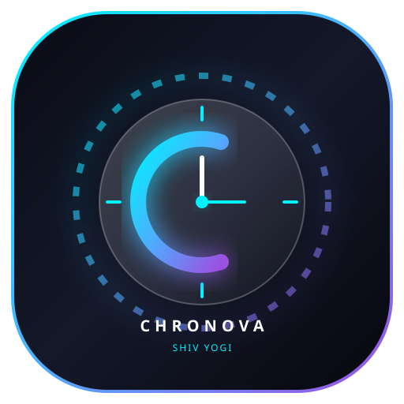

# CHRONOVA

> **Premium Interactive Digital Clock & Dynamic Wallpaper Experience**  
> *Created By Shiv Yogi*  
> *One Screen. Endless Time Experiences.*



---

## 🌟 Executive Overview

**CHRONOVA** is a production-quality, high-performance digital clock website and Progressive Web App (PWA) designed to provide an unparalleled cinematic time experience. Crafted with pure vanilla web technologies and an authentic Liquid Glass design language, CHRONOVA seamlessly blends cutting-edge visual shaders, real-time dynamic typography, multi-touch gestures, and an advanced customization suite.

Engineered specifically for zero-dependency client-side execution, CHRONOVA is 100% compatible with **GitHub Pages**, works completely offline, and respects user privacy with strictly local IndexedDB and LocalStorage persistence.

---

## ✨ Key Capabilities

1. **Ultra-Responsive Liquid Glass UI**: Frosted glassmorphism, specular highlights, border sheen, and ambient lighting synchronized with clock digits.
2. **Precision Time Engine**: Timezone detection (`Intl.DateTimeFormat`), manual timezone selection, 12/24-hour military toggles, and diff-only DOM rendering for minimal CPU usage.
3. **10+ Digital Clock Fonts**: Orbitron, Share Tech Mono, Chakra Petch, Montserrat, Rajdhani, Space Mono, Syncopate, Bebas Neue, Audiowide, Digital-7 (LED 7-Segment), and JetBrains Mono.
4. **Individual Digit Color Studio**: Long-press any clock digit (H1, H2, M1, M2, S1, S2, colons, AM/PM) to launch the floating Liquid Glass color editor with HEX validation, native RGB picker, and 16 curated neon presets.
5. **Advanced Dynamic RGB Engine**: Spectrum rainbow flow, smooth color cycling, breathing glow, per-digit phase wave offsets, and configurable interval cycles (1m, 2m, 5m, 10m).
6. **12 Dynamic Wallpapers with Built-in Clock**: Cyber Matrix, Neon Horizon, Aurora Borealis, Minimal Void, Deep Ocean Abyss, Golden Celestial, Liquid Lava Glass, Cyberpunk Cityscape, Geometric Prisms, Retro Quartz LED, Cosmic Nebula, and Zen Japanese Ink.
7. **10 Live Canvas Shader Themes**: Chromatic Flux, Deep Aurora, Electric Sunset, Midnight Obsidian, Cosmic Vapor, Neon Tokyo, Solar Flare, Bioluminescence, Hyperdrive Starfield, and Liquid Mercury.
8. **Custom Media Wallpapers**: Upload your own images or videos stored privately in IndexedDB with zoom, blur, brightness, opacity, loop, and volume controls.
9. **Smart Widget Carousel & Creator Branding**:
   - Live Date & Weekday
   - Week of Year & Day Progress
   - Timezone & UTC Offset
   - Multi-City World Clock (NYC, London, Tokyo)
   - Interactive Stopwatch with Lap timing
   - Interactive Countdown Timer with presets (5m, 10m, 25m Pomodoro) & audio gong
   - Device Battery status (`navigator.getBattery()`)
   - Live Weather via Open-Meteo API
   - **Dedicated Creator Branding Widget**: "Created By Shiv Yogi" with 12 distinct animation styles and 12 typography combinations.
10. **Always On Display (AOD)**: Screen Wake Lock API integration with auto-reacquisition, custom duration timers, idle dimming, and anti-burn-in drift to protect OLED screens.
11. **7-Step Onboarding Tutorial**: Interactive Liquid Glass onboarding cards with animated "Got It" acknowledgments and staggered digit entrance animation.
12. **Complete PWA & Offline Support**: Cache-first Service Worker, Web App Manifest, and zero network dependency.

---

## 👆 Gestures & Controls

| Gesture / Trigger | Action |
| :--- | :--- |
| **Clock Double-Tap / Double-Click** | Cycle to the next digital clock font |
| **Clock Long-Press** | Open Clock Appearance quick panel |
| **Individual Digit Long-Press / Right-Click** | Open Individual Digit Color Studio |
| **Date Double-Tap / Double-Click** | Switch active widget |
| **Date Swipe Left / Right** | Navigate carousel widgets (Next / Previous) |
| **Two-Finger Tap** | Toggle floating Liquid Glass settings shortcut |
| **Two-Finger Long-Press** | Open Quick Wallpaper Theme customizer |
| **One-Finger Swipe Up (Bottom)** | Reveal display brightness slider |
| **One-Finger Swipe Down (Top)** | Reveal quick actions drawer (Fullscreen, Theme, Power) |

---

## ⌨️ Desktop Keyboard Shortcuts

| Key | Function |
| :---: | :--- |
| <kbd>F</kbd> | Toggle Fullscreen mode & request landscape orientation |
| <kbd>S</kbd> | Open / Close full Settings drawer (15 categories) |
| <kbd>Space</kbd> | Pause / Resume wallpaper canvas animations |
| <kbd>R</kbd> | Cycle through available digital clock fonts |
| <kbd>←</kbd> / <kbd>→</kbd> | Switch widgets in the interactive carousel |
| <kbd>Esc</kbd> | Close active modal, sheet, or drawer |

*(Shortcuts are automatically disabled when typing in inputs or textareas).*

---

## 🚀 GitHub Pages Deployment Guide

Deploying CHRONOVA directly to GitHub Pages takes under 2 minutes:

1. **Create Repository**: Create a new GitHub repository (e.g. `chronova` or `<username>.github.io`).
2. **Upload Files**: Upload the contents of the `CHRONOVA` folder directly to the root of your repository branch (e.g. `main` or `gh-pages`):
   ```
   ├── index.html
   ├── manifest.json
   ├── service-worker.js
   ├── assets/
   ├── css/
   ├── js/
   └── docs/
   ```
3. **Enable GitHub Pages**:
   - Navigate to **Settings** > **Pages** in your GitHub repository.
   - Under **Build and deployment** > **Source**, select **Deploy from a branch**.
   - Choose `main` (or `gh-pages`) branch and `/ (root)` folder.
   - Click **Save**.
4. **Access Website**: Within seconds, your site will be live at:
   `https://<username>.github.io/<repository-name>/`

---

## 🔒 Privacy & Architecture

- **No Remote Tracking**: Zero analytics scripts, tracking pixels, or third-party advertising.
- **Local Media Storage**: User-uploaded wallpaper images and videos are converted into binary blobs and stored entirely inside your device's browser **IndexedDB**.
- **JSON Configuration Backup**: Full export and import options in Settings > Privacy & Backup.

---

## 👤 Creator Branding

Designed and engineered with passion by **Shiv Yogi**.  
*One Screen. Endless Time Experiences.*
